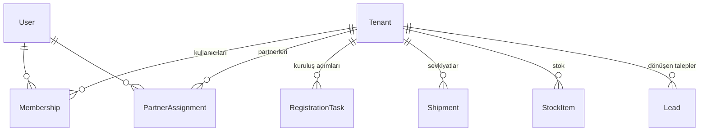

# Veri modeli (Aşama 0 taslağı)

Kaynak: `packages/db/prisma/schema.prisma`

| Model             | Tenant kapsamı | Not                                                                        |
| ----------------- | -------------- | -------------------------------------------------------------------------- |
| Tenant            | —              | Müşteri firma. Vergi no ve IBAN AES-256-GCM ile şifreli (`*Enc`)           |
| User              | —              | Ekip rolü `staffRole`; müşteri rolü `Membership` ile firma başına          |
| Membership        | **zorunlu**    | CLIENT_OWNER / CLIENT_USER                                                 |
| PartnerAssignment | **zorunlu**    | Depo vb. partnerin hizmet verdiği firmalar                                 |
| Lead              | isteğe bağlı   | Uygunluk raporu talebi; müşteri olunca `tenantId` bağlanır                 |
| RegistrationTask  | **zorunlu**    | Vekâletname → apostil → noter → sicil → vergi no → USt-IdNr → EORI → LUCID |
| Shipment          | **zorunlu**    | Fabrika → TR çıkış → AB giriş → gümrük → depo kabul                        |
| StockItem         | **zorunlu**    | SKU bazında stok                                                           |
| OutboxEvent       | sistem         | Olaylar; worker işler, idempotency anahtarı benzersiz                      |
| AuditLog          | sistem         | Giriş, yetki, dışa aktarma, fatura/stok değişiklikleri                     |
| PriceList         | sistem         | Tarih aralıklı fiyat listesi                                               |

## İzolasyon kuralı

Müşteri verisine erişen her kod `forTenant(prisma, tenantId)` istemcisini kullanır:

- okuma/güncelleme/silmeye `tenantId` filtresi eklenir; başka firma id'si verilirse `TenantScopeError`,
- oluşturmada `tenantId` zorlanır,
- tenant kapsamı dışındaki modeller ve ham SQL kapalıdır.

Testler: `packages/db/src/tenant.test.ts` (CI'da gerçek PostgreSQL ile çalışır).

## Aşama 1'de eklenecek

Quote, Contract, Document (dosya), Session, TwoFactor yedek kodları, Invoice.
